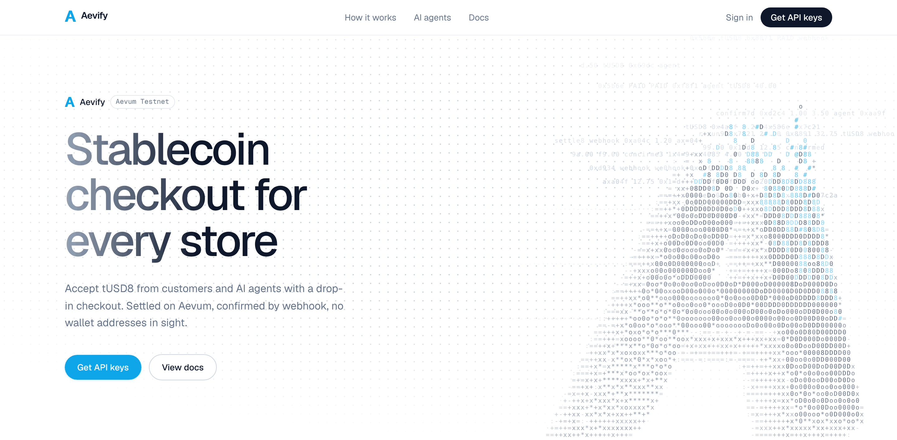
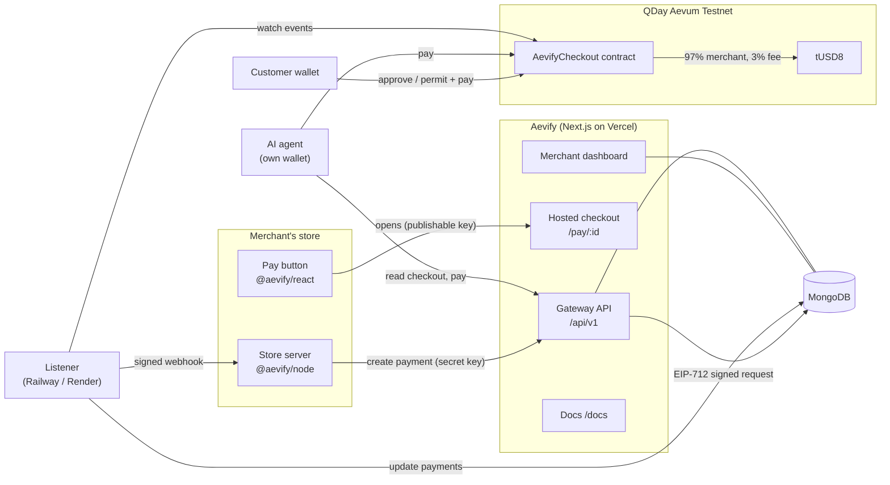
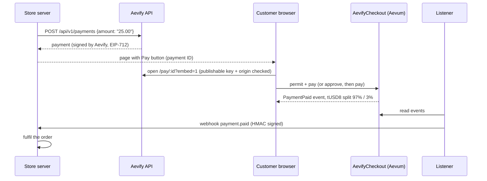

# Aevify

**Stablecoin checkout for online stores and AI agents, settled in tUSD8 on QDay Aevum Testnet.**



| | |
|---|---|
| **Live app** | https://aevify.vercel.app (docs at [aevify.vercel.app/docs](https://aevify.vercel.app/docs)) |
| **Checkout contract** | [`0x411eB280F9ED93feAC1752E30331b4B8fAFC40e8`](https://explorer-test.qday.info/address/0x411eB280F9ED93feAC1752E30331b4B8fAFC40e8) on Aevum Testnet (chain ID 44005) |
| **Stablecoin** | tUSD8 [`0x4565…3483`](https://explorer-test.qday.info/address/0x456569838f1d43009A91ebA4263147Afd7233483) |
| **Demo store** | [Admit](https://github.com/YOUR_GITHUB_USER/aevify-demo-store) (`aevify-demo-store`): an event ticket platform paid by people and an AI agent, built only on the npm packages |
| **npm packages** | [`@aevify/node`](https://www.npmjs.com/package/@aevify/node) (server SDK), [`@aevify/react`](https://www.npmjs.com/package/@aevify/react) (Pay button and modal) |
| **Challenge** | Aevum Builder Challenge #1 |

> Testnet only. tUSD8 and tQDAY are test tokens with no value.

## The problem

Online stores can't take stablecoins the way they take cards. Most crypto payment
today means showing a wallet address and hoping the customer copies it correctly, sends the
right amount, on the right network, before the price changes. Nothing tells the store when the
money arrives, and refunds are manual. That isn't something a store can put in front of
customers.

AI agents have the opposite problem. They can hold a wallet and sign transactions, but there's
no standard way for an agent to read a store's payment request, check it against its own spending
limits, pay it, and have the store fulfil the order automatically.

## What Aevify does

Aevify is a payment gateway in the style of Stripe, for tUSD8 on Aevum:

- **Merchants** sign up with email or Google, connect a payout wallet, get API keys and add a
  Pay button (`@aevify/react`) or send customers to a hosted checkout page.
- **Customers** click Pay, connect a wallet and confirm. They never copy an address or type an
  amount. With wallets that support EIP-2612 permits, it's a single transaction.
- **AI agents** pay the same checkout in code: they read the public checkout data, check their
  spending policy and pay the contract from their own wallet. A payment can be locked so that
  only one agent's wallet can pay it.
- **The store's server** is told by a signed webhook (`payment.paid`, `payment.refunded`,
  `payment.expired`), exactly like a card processor.
- **Settlement is on-chain and non-custodial:** the checkout contract sends 97% straight to
  the merchant's wallet and 3% to the fee wallet, in the same transaction. Aevify never holds
  funds.

## Architecture



| Part | What it does | Path |
|---|---|---|
| Checkout contract | Verifies Aevify's EIP-712 signature on each payment request, takes tUSD8, splits the fee, records the payment, handles refunds | `packages/contracts` |
| Gateway API | Payments, API keys, payout wallets, checkout data for agents, merchant settings | `apps/web/src/app/api` |
| Hosted checkout | Wallet connection, network switching, permit or approve + pay, receipts; embeddable in a modal | `apps/web/src/app/pay` |
| Dashboard | Overview and stats, payments, payment links, refunds, API keys, webhooks and delivery log, allowed domains, payout wallet | `apps/web/src/app/dashboard` |
| Listener | Scans the contract's events, marks payments paid or refunded, expires unpaid ones, delivers signed webhooks with retries | `apps/listener` |
| `@aevify/node` | Server SDK: create and read payments with safe retries, verify webhooks | `packages/node` |
| `@aevify/react` | Pay button and checkout modal; restricted to the merchant's allowed domains | `packages/react` |
| Docs | Quickstart, guides, API reference, AI agents, security | `/docs` |

## Core workflows

### 1. Merchant onboarding

1. Sign in with Google or an email link (Brevo SMTP).
2. Create the business, then connect a payout wallet by **signing a message with it**, which
   proves ownership so a typo can't misdirect payouts.
3. Aevify's operator key registers the merchant on the contract. The merchant needs no gas for
   this.
4. Create API keys: a **secret key** (server only, shown once, stored as a hash) and a
   **publishable key** (for the Pay button), and add the store's domains to the allow list.

### 2. A customer pays



### 3. An AI agent pays

See it live in the [Admit demo store](https://github.com/YOUR_GITHUB_USER/aevify-demo-store): its `/agent` page streams each step as the agent books event passes.


The store creates a payment, optionally locked to the agent's wallet (`payer`). The agent reads
`GET /api/v1/checkout/:id` (public, includes a ready-made contract call), checks the amount,
merchant, network and expiry against its own policy, and calls `pay` on the contract. Anything
over its limit goes to a human. The store receives the same `payment.paid` webhook. See
[/docs/agents](./apps/web/src/app/docs/agents/page.mdx).

### 4. Refunds, expiry and payout changes

- **Refunds** come from the merchant's payout wallet, go only to the original payer, and can
  never exceed what was paid. Partial refunds are supported.
- **Unpaid payments expire** (default 15 minutes); the contract rejects late payments and the
  listener sends `payment.expired`.
- **Changing the payout wallet** takes 24 hours, and the current payout wallet can cancel the
  change, so a hijacked account can't redirect money instantly.

## Safety, trust and controls

| Control | Enforced by |
|---|---|
| Amounts can't be changed after the store creates a payment (EIP-712 signature) | Contract |
| Each payment can be paid once, and only before it expires | Contract |
| Payments can be locked to one payer wallet (for AI agents) | Contract |
| Fee ceiling of 5% that even the owner can't exceed | Contract |
| Non-custodial: funds go straight from payer to merchant | Contract |
| 24-hour delayed, cancellable payout wallet changes | Contract |
| Refunds only to the original payer, never more than paid | Contract |
| Emergency pause (refunds keep working); two-step ownership transfer | Contract |
| Server keys are limited: the signer only signs, the operator only registers merchants | Contract roles |
| Secret keys hashed, shown once, revocable; SDK refuses to run in a browser | Gateway |
| Publishable key must match the payment's store; checkout embeds only on allowed domains (CSP `frame-ancestors`) | Gateway and browser |
| Webhooks signed with HMAC-SHA256, 5-minute replay window; SSRF protection on webhook URLs | Listener |
| Agent spending limits and human approval above them | Agent policy ([docs](./apps/web/src/app/docs/agents/page.mdx)) |

More in [/docs/security](./apps/web/src/app/docs/security/page.mdx) and
[packages/contracts/README.md](./packages/contracts/README.md).

## Aevum integration

- All settlement runs on **QDay Aevum Testnet** (chain ID 44005) through the
  `AevifyCheckout` contract, in **tUSD8** (6 decimals).
- The contract is compiled for the `paris` EVM and uses OpenZeppelin 5.0.2, because Aevum
  doesn't support Cancun opcodes such as `MCOPY`.
- The hosted checkout adds the Aevum network to the customer's wallet automatically.
- The listener respects the public RPC's 1,000-block `eth_getLogs` limit and adapts if a
  provider allows less.

## Technologies

| Area | Stack |
|---|---|
| Web app, API, docs | Next.js 16 (App Router), React 19, TypeScript, Tailwind CSS v4, MDX |
| Auth | Better Auth (Google OAuth, email magic links via Brevo SMTP / Nodemailer) |
| Database | MongoDB |
| Chain | viem, EIP-712 signed requests, EIP-2612 permits, EIP-6963 wallet discovery |
| Contracts | Solidity, Hardhat 3, Hardhat Ignition, OpenZeppelin Contracts 5.0.2 |
| Packages | tsup (ESM + CommonJS + types) |
| Monorepo and tooling | npm workspaces, Turborepo, Vitest, Playwright browser tests |
| Infrastructure | Docker and Docker Compose for everything, Vercel (web), Railway or Render (listener), GitHub Actions (CI and npm publishing) |

## Repository layout

```
aevify/
├── apps/
│   ├── web/                 Next.js: landing, dashboard, hosted checkout, gateway API, docs
│   └── listener/            Worker that watches Aevum and delivers webhooks
├── packages/
│   ├── contracts/           AevifyCheckout (Hardhat 3), tests, deploy and admin scripts
│   ├── shared/              Types, chain constants, payment records, webhook signing
│   ├── node/                @aevify/node
│   ├── react/               @aevify/react
│   ├── tailwind-config/     Design tokens for Tailwind CSS v4
│   └── typescript-config/   Shared tsconfig
├── docker/                  Dev image and dependency installer
├── DEPLOY.md                Contract, Vercel, listener and npm deployment, step by step
├── docker-compose.yml
├── Makefile
└── .github/workflows/       CI and npm publishing
```

## Run it locally

Everything runs in Docker; you only need Docker Desktop (or Docker Engine with Compose).

```bash
cp .env.example .env         # fill in MONGODB_URI, BETTER_AUTH_SECRET and the chain settings
docker compose up web        # http://localhost:3000
docker compose up listener   # http://localhost:8080/health
```

Without Brevo configured, sign-in links are printed in the terminal. Check the setup at
http://localhost:3000/api/health.

## Tests

```bash
make test        # contracts, API, listener and SDK unit tests
make e2e         # end-to-end against a local chain (payments, refunds, listener, webhooks)
make typecheck
```

What's covered:
- **Contract tests:** signatures, fees and the fee cap, expiry, payer locks, refunds, payout
  delays, pause, roles.
- **API tests:** auth, keys, idempotency, embedding rules, webhook deliveries, the Node SDK
  running against the real route handlers.
- **Listener tests:** scanning, confirmations, RPC range limits, expiry, retries, SSRF.
- **Browser tests:** onboarding, payout wallet, permit and approve payments, payer locks, the
  React modal, framing rules and refunds.

## Deployment

Covered step by step in [DEPLOY.md](./DEPLOY.md):
- **Contract:** deployed and verified on Aevum from Docker.
- **Web app:** Vercel, with `apps/web` as the root directory.
- **Listener:** Railway or Render, from `apps/listener/Dockerfile`.
- **npm packages:** published from GitHub Actions on a version tag.

## Roadmap

- **Card payments** through processor partners, with a settlement hold to protect against
  chargebacks.
- **Payments from other networks** once the QDay Bridge is live.
- **x402 pay-per-request** for merchant APIs consumed by AI agents.
- **MCP tool** so merchants' AI assistants can create payment links and issue refunds.

## Third-party dependencies

Direct dependencies and their licenses. All are permissive and compatible with MIT.

| Package | License | Used for |
|---|---|---|
| next, react, react-dom | MIT | Web app |
| tailwindcss, @tailwindcss/postcss | MIT | Styling |
| @next/mdx, @mdx-js/loader, @mdx-js/react, remark-gfm, rehype-slug | MIT | Docs pages |
| geist | SIL Open Font License 1.1 | Fonts |
| better-auth | MIT | Sign-in and sessions |
| nodemailer | MIT-0 | Sign-in emails (Brevo SMTP) |
| mongodb | Apache-2.0 | Database driver |
| zod | MIT | Request validation |
| viem | MIT | Aevum RPC, signatures, contract calls |
| @openzeppelin/contracts 5.0.2 | MIT | SafeERC20, permits, EIP-712 and ECDSA, two-step ownership, pausing, reentrancy guard |
| hardhat, @nomicfoundation/hardhat-toolbox-viem, @nomicfoundation/hardhat-ignition | MIT | Contract development, tests, deployment |
| typescript | Apache-2.0 | Language |
| turbo | MIT | Monorepo tasks |
| tsup, tsx | MIT | Building packages and the listener |
| vitest | MIT | Tests |
| @types/* | MIT | Type definitions |

Browser tests use Playwright (Apache-2.0). No third-party source code is copied into this
repository.

## License

[MIT](./LICENSE)
